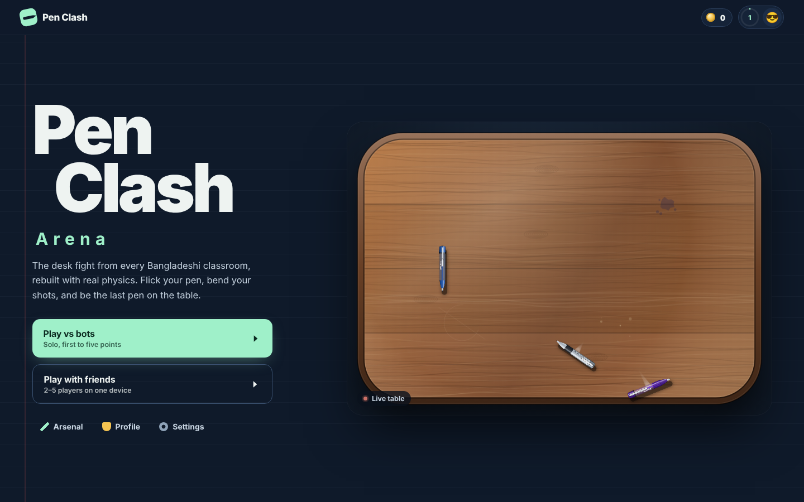
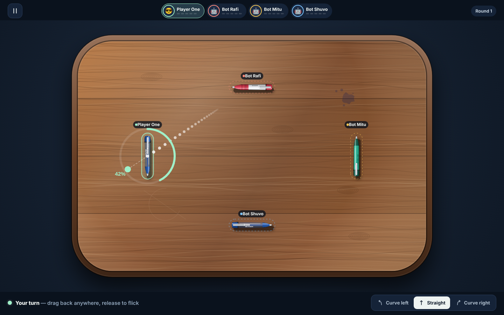
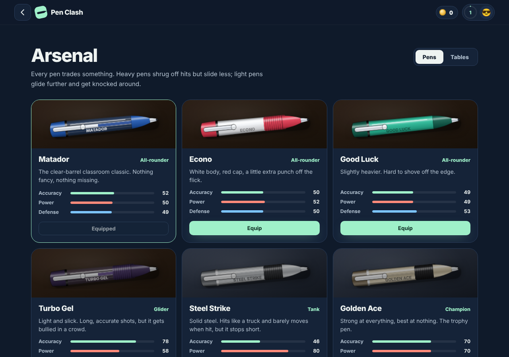
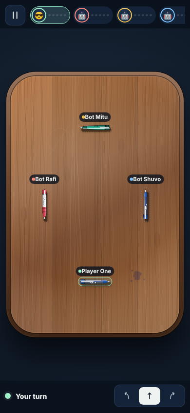

# Pen Clash Arena

A physics pen-fight game inspired by the pen battles played on classroom desks across Bangladesh. Flick your pen, bend your shots, and be the last pen on the table. First to five points wins.



| Aiming | Arsenal | Phone |
|---|---|---|
|  |  |  |

## Play locally

No build step. Open `dist/index.html` in a browser, or serve the folder:

```bash
npx serve dist
```

## Controls

- **Aim:** press anywhere on the table on your turn and pull back like a slingshot. The dotted line shows where your pen will go; it turns red if the shot would take you off the table.
- **Power:** the further you pull, the harder the flick.
- **Curves:** pick *Curve left* or *Curve right* before shooting to bend around a blocker.
- **Pause:** the button at the top left, or `Esc`.

## Features

**Working now**
- Matches against bots (Easy / Normal / Hard) and pass-and-play for 2–5 players
- Capsule physics with rotation, mass and spin
- Six pens with different trade-offs, unlocked with coins
- Three table shapes, each with its own knockout edge, and eight finishes
- Coins, XP and levels; local player profiles with emoji or photo avatars
- Procedural sound effects, volume control, screen-shake toggle, battery saver

**Not built yet**
- Online rooms and invite links
- Cloud accounts (records are stored in the browser only)
- Leaderboards, achievements, daily challenges
- Android app

## Project structure

```
dist/
  index.html   all screens: home, setup, play, arsenal, profile, settings
  style.css    the visual system
  game.js      physics, rendering, audio, bot AI, game flow, storage
docs/screenshots/
.github/workflows/pages.yml   deploys dist/ to GitHub Pages
.openai/hosting.json          ChatGPT Sites config (safe to delete if you don't use it)
```

### Tuning

Pen stats live in the `PENS` array at the top of `dist/game.js`:

- **Accuracy** lengthens the aim guide and steadies the shot
- **Power** raises launch speed and knockback
- **Defense** adds mass, so the pen resists hits but slides less on its own shot

Physics constants (`MU`, `REST`, `AMU` …) sit just below the table geometry code.

### Saved data

Stored in `localStorage` under `penclash-save`, `penclash-profiles-v3`, `penclash-shape`, `penclash-sound` and `penclash-settings-v7`.

## Deploying

**GitHub Pages:** push to `main`, then in the repo go to *Settings → Pages* and set *Source* to **GitHub Actions**. The included workflow publishes `dist/` on every push.

**Netlify / Cloudflare Pages:** set the publish directory to `dist`, with no build command.

## Credits

Original prototype. Pen names (Matador, Econo, Good Luck) are used as nods to familiar Bangladeshi stationery; the artwork is original and not affiliated with any brand.

Made in Bangladesh 🇧🇩
